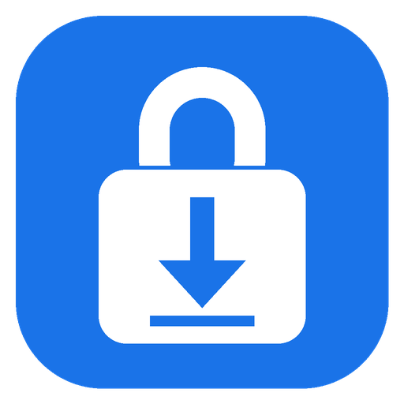
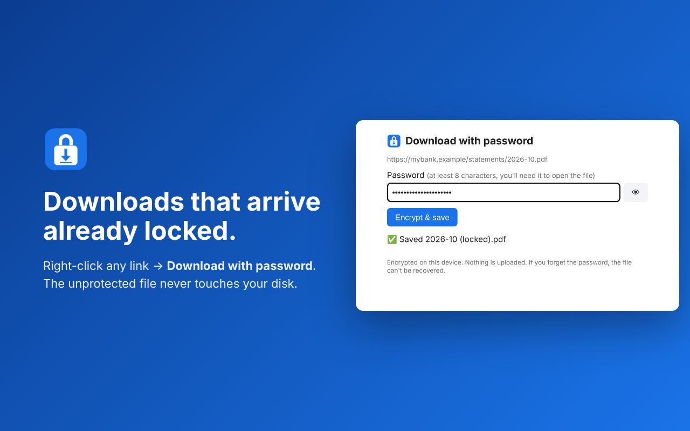

<p align="center"></p>

# SecureDL

**Downloads that arrive already locked.** A Chrome extension that saves sensitive downloads, like bank statements, tax forms and ID scans, password-protected. The unprotected file never touches your disk. Everything runs locally.



## Why

On a Mac, the usual routine is: download the PDF, open it in Preview, File → Export, tick *Encrypt*, type a password, save, then delete the original. Most people skip it, and the files sit unprotected in Downloads, or sync to iCloud Drive or Google Drive.

SecureDL turns that into one step: right-click → **Download with password**.

## How the files open (nothing to install)

| Downloaded file | Saved as | Opens with |
|---|---|---|
| PDF | `name (locked).pdf`, standard AES-256 PDF encryption | Double-click → Preview / Acrobat / Chrome ask for the password |
| Anything else | `name.locked.html`, AES-256-GCM, PBKDF2-SHA256 (600k iterations) | Double-click → type the password in your browser → original file is saved |

The `.locked.html` file is a small, self-contained page with no network access. It works offline on Mac, Windows, Linux and phones. The original filename is encrypted too.

Try it: `samples/` has one of each. The password is `test1234`.

## Install

- **Chrome Web Store:** _coming soon_
- **From source:** clone this repo → `chrome://extensions` → turn on Developer mode → **Load unpacked** → select `ext/`.

## Use

- Right-click a link, image or video → **Download with password**.
- Toolbar icon → **Protect every download** to route every download through SecureDL.
- Toolbar icon → **Lock a file already on disk**.

## Security model

- **Local only.** No servers, accounts, analytics or remote code. See [PRIVACY.md](PRIVACY.md).
- **Minimal permissions.** No website access at install. A right-click gives temporary access to that one tab (`activeTab`). Other sites are requested one at a time if needed, and all sites only if you turn on "Protect every download".
- **Fetches like the page does.** The file is fetched from inside the tab you right-clicked in, so sign-ins and bot checks (for example Cloudflare) behave as they do for a normal download.
- **Refuses junk.** If a site returns a bot-check, login, error or empty page instead of the file, nothing is saved.
- **No recovery.** There is no backdoor and no password reset. Lose the password and the file is gone. Use a password manager.

What it does **not** protect against: malware on your computer, or someone watching you type the password. The file is held in memory unencrypted while it's being encrypted. Encryption also adds no protection once you unlock and save the original somewhere.

## Limitations

- Files a site generates in the page itself (`blob:` downloads) can't be re-fetched. Download normally, then use **Lock a file already on disk**.
- Very large files (hundreds of MB) are processed in memory.
- PDFs that are already encrypted are saved as `.locked.html` instead.

## Development

```bash
npm install
npm test          # unit tests (needs qpdf) + end-to-end tests in real Chrome
npm run build     # dist/securedl-<version>.zip, ready for the Chrome Web Store
npm run screenshots
```

The end-to-end suite loads the extension into Chrome and types passwords with real keystrokes. It runs against a local server that imitates a Cloudflare-protected PDF, a login page and an image. It also checks that the shipped manifest requests no site access up front.

## License

MIT. Bundles [pdf-lib](https://github.com/cantoo-scribe/pdf-lib) (MIT).
